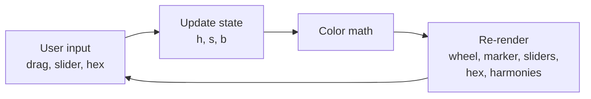

# Tzeva — PRD

Sep 24, 2026 · @Yuval · updated Oct 14, 2026

## Overview

Tzeva (Hebrew for "color") is a color wheel web app that installs on an iPhone home screen and works offline. It lets the user pick colors by dragging on a wheel, read and enter hex codes, see color harmonies with their hex codes, and collect colors into a palette that's remembered between sessions.

The primary user is the author, for color theory study and design work. The app is a static site hosted on GitHub Pages, with no backend and no accounts.

## Goals and non-goals

The app succeeds if picking a color and reading its harmonies takes one drag, with every value updating live.

**Goals**

- Open from the iPhone home screen in under 1 second, full-screen, with no browser bars
- Work fully offline after the first load
- Keep the wheel, marker, sliders, hex field and harmony swatches in sync at all times
- Feel smooth while dragging (60 fps on a recent iPhone)
- Remember the saved palette across reloads and sessions

**Non-goals (v1)**

- Native App Store app
- Accounts, sync or a backend
- Multiple named palettes, or color history
- Color spaces beyond HSB, RGB and hex (e.g. LAB, CMYK)

## Features and requirements

Eight features. F1–F6 are driven by one shared color state (hue, saturation, brightness); F7 adds a palette tab that persists across sessions; F8 adds picking a color from a photo.

| # | Feature | Requirements |
| --- | --- | --- |
| F1 | Color wheel | Hue by angle (0° red at the top, clockwise), saturation by distance from center (0% center, 100% rim). Brightness applies to the whole wheel. |
| F2 | View modes | Toggle between Gradient (smooth) and Segmented (clear borders). Segmented uses 12 hue slices and 5 saturation rings (fixed, not adjustable). A second toggle switches the wheel between RGB and RYB (painter's) models. |
| F3 | Drag marker | Tap anywhere on the wheel to jump the marker there, then drag. Marker clamps to the rim if the finger leaves the wheel. Touch target at least 44 pt. A preview bubble above the finger shows the current color while dragging. In Segmented mode the marker snaps to slice and ring centers while dragging. Switching modes never changes the selected color; the marker keeps its exact position until the next drag. |
| F4 | HSB sliders | Three sliders: Hue 0–360, Saturation 0–100, Brightness 0–100, each with a numeric readout. Slider tracks show the color range they control. |
| F5 | Hex output and input | Selected color shows its hex code in an editable field with a copy icon. A text field accepts `#RRGGBB`, `RRGGBB` or `#RGB`, case-insensitive. Typed input applies on Return or when the field loses focus. Invalid input shows an inline error and changes nothing. Valid input moves the marker and sliders. |
| F6 | Harmonies | Dropdown picker for Complementary, Split complementary, Analogous, Triadic, Tetradic (square). Each harmony color gets its own row with a swatch and its hex code, matching the main swatch row; a copy icon copies it, matching the main row. Long-press a swatch, or tap its dot on the wheel, to make it the selected color. Harmony positions appear as small dots on the wheel while the Harmonies view is open. |
| F7 | Palette | Every swatch row on the main screen (the selected color row and each harmony row) has an Add to palette button (+ icon) at its end, outside the hex field. Tapping it appends that hex to the palette and shows a short "Added to palette" confirmation; a hex already in the palette is not added twice and shows "Already in palette". The Palette tab lists the saved colors in the order they were added, one row per color, identical to the main swatch row (swatch, hex code, copy icon) except that the + button is replaced by a delete button (trash icon) that removes the row immediately. Tapping a palette row, or its dot on the wheel, makes that color the selected color; the row and dot matching the current color are highlighted. Each palette color appears as a dot on the wheel while the Palette tab is open, positioned by its own hue and saturation and filled with its actual color (including brightness); colors sharing a hue and saturation are spread apart slightly so every dot stays visible and tappable. The palette persists across reloads and sessions (stored in the browser, see Technical architecture). |
| F8 | Photo color picker | A photo icon in the wheel's top-left corner (matching the settings icon's style) opens the standard iOS image picker (Photo Library, Take Photo, or Choose File; no live camera view). The chosen photo opens full-screen over the main screen, fitted to the screen on the dark neutral background, respecting its EXIF orientation. Touch and drag on the photo shows a magnifier loupe above the finger (below it near the top edge, clamped to stay on screen): an enlarged, pixelated view of the area under it, a crosshair at its center, and the live hex code of the color there — always the average of a 3×3 pixel block, with no setting to change that. Lifting the finger makes that color the selected color (marker, sliders, hex) and closes the photo view; it is not added to the palette. The photo stays loaded in memory for the rest of the session: tapping the photo icon again reopens the same photo, with a button in the photo view to choose a different one instead. Everything happens on the device; nothing is uploaded. |

## Color math

All color logic lives in one pure module with no UI code, so it can be unit-tested on its own.

**Functions**

- `hsbToRgb(h, s, b)` → `{r, g, b}` in 0–255
- `rgbToHsb(r, g, b)` → `{h, s, b}`
- `rgbToHex(r, g, b)` → `"#RRGGBB"` (uppercase)
- `parseHex(str)` → `{r, g, b}` or `null` if invalid
- `pointToHS(x, y, center, radius)` → hue and saturation from a touch point, saturation clamped to 100
- `hsToPoint(h, s, center, radius)` → marker position
- `harmonies(h, type)` → list of hues

**Wheel geometry** (angle measured from the top, clockwise):

```latex
h = \operatorname{atan2}(x - c_x,\; c_y - y) \bmod 360^\circ \qquad s = \min\left(1,\; \frac{\sqrt{(x-c_x)^2 + (y-c_y)^2}}{r}\right)
```

**Harmony hue offsets**

| Harmony | Hue offsets |
| --- | --- |
| Complementary | +180° |
| Split complementary | +150°, +210° |
| Analogous | −30°, +30° |
| Triadic | +120°, +240° |
| Tetradic (square) | +90°, +180°, +270° |

Harmony colors keep the selected color's saturation and brightness.

**Wheel model:** v1 uses the digital RGB wheel, where red's complement is cyan. A toggle switches to the traditional painter's RYB wheel, where red's complement is green.

**RYB mapping:** state always stores standard HSB hue. RYB mode only changes how a wheel angle maps to hue, which affects drawing, marker placement, segment snapping and harmony offsets. The mapping is piecewise linear between these anchors:

| Color | RYB wheel angle | HSB hue |
| --- | --- | --- |
| Red | 0° | 0° |
| Orange | 60° | 30° |
| Yellow | 120° | 60° |
| Green | 180° | 120° |
| Blue | 240° | 240° |
| Violet | 300° | 270° |

In RYB mode, harmony offsets are applied to the RYB angle, then converted back to HSB hue. Functions: `rybAngleToHue(a)` and `hueToRybAngle(h)`. The HSB slider always shows standard hue so values match other design tools.

**Round-trip rule:** entering a hex code, then reading it back, must return the same hex. HSB values are stored as floats and only rounded for display, so dragging doesn't drift the color.

**Undefined hue:** when saturation or brightness is 0 (grays, black, white), hue is undefined. The app keeps the previous hue instead of resetting to 0, so typing a gray and then raising saturation returns to the earlier hue.

**Photo color math** (`photoColor.ts`, see F8): a second pure module, kept separate from `color.ts` since it's about reading pixels rather than color space conversions.

- `downscaleSize(width, height, maxSide)` → `{width, height}`: scales down so the longest side is at most `maxSide` (2048 in the app), preserving aspect ratio; never upscales.
- `average3x3(data, width, height, x, y)` → `{r, g, b}`: averages the 3×3 pixel block centered on `(x, y)`; neighbors past an edge are clamped to the nearest edge pixel rather than skipped, so a corner pixel still averages 9 samples, some repeated.
- `screenToImage(clientX, clientY, rect, imgWidth, imgHeight)` → `{x, y}`: maps a screen point to an image pixel, for an image shown in `rect` with `object-fit: contain` (scaled to fit, centered, letterboxed); a point in the letterbox margin, or otherwise outside the image, clamps to the nearest edge pixel.

## UI layout and interaction

One page, no separate Palette page. Switching tabs never changes the selected color or the palette.

One portrait screen with no page scrolling, sized for iPhone widths from 375 pt up. The wheel and swatch row are fixed; the area below them switches between three views.

1. **Color wheel**, top middle, about 85% of screen width. A photo icon in the top-left corner opens the photo color picker (F8). A settings icon in the top-right corner opens a popover with the Gradient / Segmented and RGB / RYB toggles. The RGB/RYB mode is not shown outside the popover.
2. **Swatch row**: the selected color swatch, an editable hex field with a copy icon at its end, and an Add to palette (+) button after the field. Tapping the text edits it; tapping the copy icon copies; tapping + saves the color to the palette.
3. **Switching view**, directly under the swatch row:
   - **Sliders** (default at launch): Hue, Saturation and Brightness with numeric readouts
   - **Harmonies**: one row per harmony color (swatch, hex code, copy icon and + button, styled like the main swatch row), stacked directly under the main swatch row, with the harmony dropdown pinned just above the Sliders | Harmonies | Palette control so it never moves. Harmony dots show on the wheel only while this view is open.
   - **Palette**: one row per saved color, in the order added: swatch, read-only hex code with a copy icon, and a delete (trash) button; tapping a row (outside its copy/delete icons) selects that color, and the row matching the current color is highlighted. This list scrolls on its own if it is taller than the available space; the page itself still never scrolls. When empty, a short hint says to tap + on any color row to add it. Palette dots show on the wheel only while this view is open, each filled with its own color and positioned by its own hue and saturation; the dot matching the current color is highlighted, and dots that would otherwise land on the same spot (same hue and saturation) are spread apart so each stays visible and tappable.
4. **Segmented control** (Sliders | Harmonies | Palette) at the bottom of the screen, above the home indicator.

Brightness can only be changed in the Sliders view. This is intentional.

**Photo view**

Opened by the photo icon (F8), over the main screen rather than as a tab, since it's a brief picking flow rather than a place to linger.

1. The photo fills the screen (`object-fit: contain`) on the dark neutral background, oriented per its EXIF data.
2. A close button and a "choose a different photo" button sit in the top corners over the photo.
3. Touch and drag anywhere on the photo shows the loupe above the finger (or below, flipped, near the top edge — the same flip the wheel's drag-preview bubble uses — and clamped so it never runs off any screen edge), live-updating as the finger moves. Lifting the finger picks the color under the crosshair and closes the view.

**Interaction details**

- The wheel uses `touch-action: none` so Safari never scrolls or bounces while dragging
- Pointer events handle touch, mouse and Apple Pencil the same way, so the app can be tested on a computer
- Copying a hex code shows a short "Copied" confirmation
- Content respects the iPhone safe areas (notch and home indicator)
- Dark mode only; the background is a neutral dark gray with no warm or cool tint so it doesn't distort color perception
- The hex field opens a text keyboard with autocorrect and autocapitalize off
- The photo picker has no `capture` attribute, so iOS offers Photo Library, Take Photo and Choose File — never a live in-page camera view

## Technical architecture

React + TypeScript built with Vite, output as static files. One state object drives every component.

**State**

```
{ h: number, s: number, b: number,      // floats: 0–360, 0–1, 0–1
  mode: "gradient" | "segmented",
  wheel: "rgb" | "ryb",
  harmony: "complementary" | "split" | "analogous" | "triadic" | "tetradic" }
```

The palette (`string[]` of `#RRGGBB` hex codes) and the current view (`"sliders" | "harmonies" | "palette"`) are kept in React state next to the color state. The view resets on reload; the palette doesn't — it's mirrored to `localStorage` as versioned JSON (`{ version, colors }`) on every change and reloaded on launch, so it survives reloads and app restarts. Missing or broken stored data (wrong version, invalid JSON, non-hex entries) is dropped in favor of an empty palette rather than crashing.

The loaded photo (a processed, ready-to-sample canvas) and whether the photo view is open are also React state, kept in memory only — neither is persisted, so both are gone after an app restart, but the photo itself survives closing and reopening the view within the same session.



Every input writes to state; every view reads from it. No component updates another directly.

**Components**

| Component | Responsibility |
| --- | --- |
| `ColorWheel` | Canvas drawing of the wheel; redraws only when brightness or mode changes |
| `WheelMarker` | Marker, harmony/palette dots and pointer handling; overlaid on the canvas so dragging doesn't redraw the wheel |
| `HsbSliders` | Three sliders bound to h, s, b |
| `HexField` | Hex display, copy and validated input |
| `HarmonyPanel` | Harmony picker and swatches |
| `ColorRow` | Shared swatch + hex + copy row, with an optional add (+) or delete (trash) button and an optional select-on-tap, at its end |
| `PaletteTab` | Palette tab: list of saved color rows (select, delete), empty state |
| `PhotoView` | Full-screen photo view: the photo, the loupe, pointer handling, close and choose-different buttons |
| `color.ts` | Pure color math module (see Color math) |
| `dotLayout.ts` | Pure geometry: spreads wheel dots apart when more than one would land on the same spot |
| `palette.ts` | Pure persistence: load/save the palette to `localStorage` |
| `photoColor.ts` | Pure photo math: 3×3 averaging, downscale size, screen-to-image mapping (see Photo color math) |
| `loadPhoto.ts` | Decodes a picked file into a ready-to-sample canvas (EXIF orientation, downscale); the one DOM-dependent piece, kept separate from the pure math |

**Performance:** the wheel is drawn once per brightness or mode change using `ImageData`, sized for the device pixel ratio so it stays sharp on Retina screens. Dragging only moves the marker layer.

## Packaging and deployment

The app ships as a static site on GitHub Pages and installs via Safari's Add to Home Screen. There is no build server or cost.

**Hosting**

- Public GitHub repo, for example `tzeva`, served at `<username>.github.io/tzeva`
- Vite `base` set to `/tzeva/` so asset paths resolve under the repo path
- A GitHub Actions workflow builds and deploys on every push to `main`

**Home-screen app pieces**

| Piece | Purpose |
| --- | --- |
| `manifest.json` | Name and short name "Tzeva", theme color, `"display": "standalone"` so it opens without Safari bars, and orientation locked to portrait |
| `apple-touch-icon` (180×180 PNG) | Home-screen icon on iOS: the app's own gradient color wheel (no marker, darkened slightly so the wordmark stays clear in grayscale), with "Tzeva" in a bold sans-serif centered over it, on the dark neutral gray background |
| `<meta name="viewport" ... viewport-fit=cover>` | Full-screen layout that respects safe areas |
| Service worker | Caches all files after the first visit so the app opens instantly and works offline |

The `vite-plugin-pwa` plugin generates the manifest and service worker from config.

**Icon generation:** the source is kept as SVG (`assets/icon.svg`, plus a padded `assets/icon-maskable.svg` for the maskable manifest icon), not just as PNGs. `scripts/gen-icons.mjs` rasterizes it to `apple-touch-icon.png` (180×180), `icon-192.png`, `icon-512.png` and `icon-maskable-512.png`. The gradient wheel in the icon is produced by running the app's own `drawWheel()` in headless Chrome (not a redrawn approximation), darkened a bit from the app's own wheel so the wordmark stays legible even in grayscale. "Tzeva" is converted from a bundled bold sans-serif font to vector paths, so the generated PNGs don't depend on any font being installed on the machine that renders them.

**Install on iPhone:** open the URL in Safari, tap Share, then Add to Home Screen.

**Updates:** push to `main`. The service worker picks up the new version on the next launch, and the app shows a small "Update available, tap to reload" banner.

## Acceptance criteria

- [ ] Entering `#FF0000` puts the marker at the top rim; complementary shows `#00FFFF`
- [ ] In RYB mode, red's complement is green and yellow's is violet
- [ ] Switching RGB / RYB keeps the selected color and moves the marker to its new position; switching Gradient / Segmented leaves the color and hex unchanged
- [ ] Entering any valid hex and reading it back returns the same hex; entering a gray keeps the previous hue
- [ ] Dragging updates marker, sliders, hex and harmonies with no visible lag on iPhone
- [ ] Dragging past the rim keeps the marker on the rim
- [ ] Page never scrolls or bounces while dragging on the wheel
- [ ] Invalid hex (e.g. `#GGG`) shows an error and changes nothing
- [ ] Segmented mode shows 12 slices and 5 rings with clear borders, and the marker snaps to segments
- [ ] Installed from the home screen, the app is named Tzeva, opens full-screen and works in airplane mode, and its icon shows the gradient wheel with "Tzeva" legible over it
- [ ] Tapping + on the main row or a harmony row adds that hex to the Palette tab; tapping + again on the same hex does not add a duplicate
- [ ] Deleting a row in the Palette tab removes only that color
- [ ] Switching tabs keeps the selected color and the palette
- [ ] Tapping a palette row, or its dot on the wheel, selects that color, and the matching row and dot are highlighted
- [ ] Two palette colors with the same hue and saturation but different brightness show as two distinct, tappable dots on the wheel, not stacked on one spot
- [ ] Reloading the app, or reopening it after fully closing it, keeps the saved palette; clearing or corrupting the stored palette data starts with an empty palette instead of crashing
- [ ] The photo icon opens the standard iOS picker with no live camera view (Photo Library, Take Photo, Choose File)
- [ ] A photo taken in portrait orientation (or any other EXIF orientation) displays upright, not sideways
- [ ] Dragging on the photo shows a live hex readout in the loupe that updates as the finger moves, always the average of the 3×3 block under the crosshair
- [ ] Lifting the finger on the photo sets the marker, sliders and hex to that color, closes the photo view, and does not add it to the palette
- [ ] Reopening the photo icon after picking a color shows the same photo again, without re-opening the system picker
- [ ] A very large photo (e.g. a modern iPhone's full-resolution shot) opens without error, downscaled so its longest side is at most 2048 px

## Milestones

| # | Milestone | Done when |
| --- | --- | --- |
| M1 | Color math | `color.ts` with unit tests for all conversions and harmonies |
| M2 | Wheel + drag | Gradient wheel renders; marker drags and clamps |
| M3 | Controls | Sliders and hex field in sync with the wheel |
| M4 | Harmonies + modes | Harmony panel, wheel dots, segmented mode, RYB toggle |
| M5 | Ship | GitHub Pages deploy, manifest, icon, service worker, installed on iPhone |
| M6 | Palette | + buttons on main-page rows, Palette page with delete, page switching |
| M7 | Palette tab, persistence, icon | Palette moved into a third tab with wheel dots and overlap spreading; palette persists via `localStorage`; new home-screen icon generated from a source SVG |
| M8 | Photo color picker | `photoColor.ts` with unit tests; photo icon, full-screen photo view with the loupe, EXIF orientation and downscaling handled |

## Open questions

- Reopen with the last selected color and view, or start fresh each launch? (The palette now persists; the color, view and settings still don't.)
- Harmony dropdown position: starting pinned above the view toggle; may move it to the top of the Harmonies view after trying it
